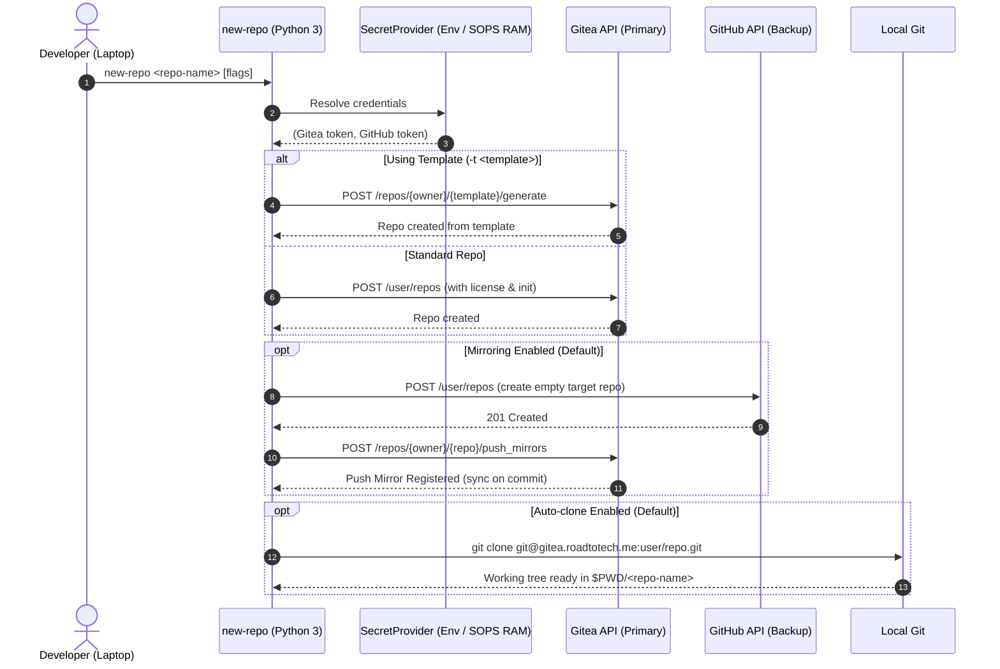

# 🚀 `new-repo` — Automated Repository Provisioning CLI

`new-repo` is a lightweight, zero-dependency Python 3 command-line utility that automates repository provisioning across a hybrid Git topology:
- **Primary Forge**: Self-hosted Gitea instance (`gitea.roadtotech.me`).
- **Offsite Backup Forge**: GitHub (`github.com`) via automated push mirroring.

It eliminates repetitive manual setup by providing sensible defaults (Gitea as primary, automated GitHub push mirroring, `UNLICENSE` default, private visibility, auto-clone locally into `$PWD/<name>`) while supporting Gitea repository templates and optional standalone configurations.

---

## 🎯 Architecture & Design Principles

1. **Zero External Dependencies**: Implemented strictly with the Python 3 standard library (`urllib.request`, `argparse`, `json`, `subprocess`, `dataclasses`, `typing`). No virtual environments, compilation steps, or pip packages required.
2. **12-Factor Environment Configuration**: Standard environment variables (`GITEA_TOKEN`, `GITHUB_TOKEN`) serve as the primary contract. The tool runs anywhere—inside or outside Nix, locally, or in CI/CD pipelines—with no code modifications.
3. **Transparent SOPS Fallback**: For daily workstation usage, when environment variables are not exported in the shell, credentials resolve transparently from SOPS-encrypted files (`~/Config/secrets.yaml` or legacy `Homelab` secrets) in process memory.
4. **Strict Typing & Linting**: Built with full static type annotations passing **Pyright** with 0 errors and styled with **Ruff**.

See our Architecture Decision Records in [`docs/adr/`](docs/adr/):
- [**ADR 001**: Adopt Zero-Dependency Python Over Compiled Rust](docs/adr/0001-adopt-zero-dependency-python.md)
- [**ADR 002**: Environment Variables as Primary Configuration Interface with Pluggable Secret Resolvers](docs/adr/0002-environment-variables-as-primary-interface-with-sops-fallback.md)
- [**ADR 003**: Dual-Forge Topology with Automated Push Mirroring and Retain-and-Report Error Policy](docs/adr/0003-dual-forge-topology-with-automated-push-mirroring.md)

---

## 💻 CLI Usage

```text
Usage: new-repo <NAME> [OPTIONS]

Arguments:
  name                  Name of the repository to create

Options:
  -p, --public          Make repository public (default: private)
  -d, --description     Optional repository description
  -l, --license         License template identifier (default: UNLICENSE)
  -t, --template        Optional Gitea template repository ('[owner/]template-name')
  -M, --no-mirror       Disable automatic offsite push mirroring to GitHub
  --no-clone            Skip cloning repository locally after creation
  -h, --help            Show help message and exit
```

### Examples

```bash
# 1. Standard creation (Gitea + GitHub push mirror + UNLICENSE + private + auto-clone)
new-repo my-microservice

# 2. Generate from a Gitea template repository
new-repo auth-api --template template-python-api

# 3. Local-only Gitea repo (no GitHub mirror)
new-repo private-notes --no-mirror

# 4. Public repository with MIT license
new-repo open-tool --public --license MIT
```

---

## 🔐 Credentials Configuration

### Option A: Standard Environment Variables (Any System / CI)
Export credentials in your environment or place them in a `.env` file:
```bash
export GITEA_TOKEN="your_gitea_api_token"
export GITHUB_TOKEN="your_github_token"
export GITEA_URL="https://gitea.roadtotech.me"  # optional, default
export GITEA_USER="kiskaadee"                   # optional, default
export GITHUB_USER="kiskaadee"                  # optional, default
```

### Option B: SOPS Workstation Encryption (Workstation Default)
On your laptop, store tokens in `~/Config/secrets.yaml`:
```bash
sops ~/Config/secrets.yaml
```
```yaml
system:
  gh_repo_token: <github_pat>
gitea:
  api_token: <gitea_pat>
```

---

## 🏛️ System Workflow



---

## 🧪 Verification & Development

Run static checks using the configured toolchains:
```bash
# Type check
pyright new_repo.py

# Lint & Format checks
ruff check new_repo.py
ruff format --check new_repo.py
```
