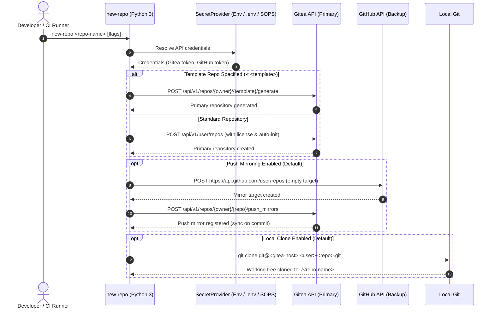
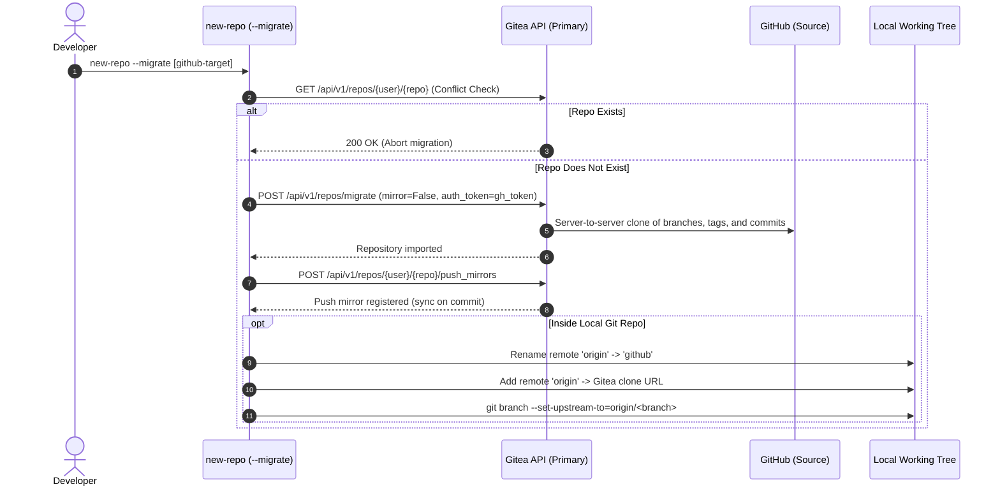

# `new-repo` — Automated Repository Provisioning CLI

`new-repo` is a portable, zero-dependency Python 3 command-line utility designed to automate repository provisioning across a dual-forge Git topology:
- **Primary Forge**: A self-hosted Gitea instance for local sovereignty and CI/CD automation.
- **Backup Forge**: GitHub for offsite redundancy via automated server-side push mirroring.

It automates the multi-step setup required to create a repository, establish push mirroring, and prepare a local working tree in a single command.

---

## 🎯 Key Design Principles

1. **Zero External Dependencies**: Built strictly with Python 3 standard library modules (`urllib.request`, `argparse`, `json`, `subprocess`, `dataclasses`, `typing`). Requires no virtual environment, compilation step, or third-party package installation.
2. **Universal Portability (12-Factor)**: Standard environment variables (`GITEA_TOKEN`, `GITHUB_TOKEN`) and optional `.env` files serve as the primary configuration contract. The utility runs out-of-the-box on any POSIX system, container, or CI/CD runner.
3. **In-Memory Credential Safety**: Tokens are injected exclusively via native HTTPS authorization headers. Secrets are never passed as command-line arguments to subprocesses, preventing exposure in system process tables (`ps`, `/proc/$PID/cmdline`) or persistent disk logs.
4. **Resilient Failure Recovery**: Adheres to a *retain-and-report* policy. If backup mirror provisioning or push mirror registration encounters an error after the primary repository is created, the primary repository is preserved and diagnostic URLs are printed for manual review.
5. **Strict Static Typing**: Enforces full static type hints validated via **Pyright** and formatted/linted via **Ruff**.

Architecture Decision Records (ADRs) are maintained in [`docs/adr/`](docs/adr/):
- [**ADR 001**: Adopt Zero-Dependency Python Over Compiled Rust](docs/adr/0001-adopt-zero-dependency-python.md)
- [**ADR 002**: Environment Variables as Primary Configuration Interface with Pluggable Secret Resolvers](docs/adr/0002-environment-variables-as-primary-interface-with-sops-fallback.md)
- [**ADR 003**: Dual-Forge Topology with Automated Push Mirroring and Retain-and-Report Error Policy](docs/adr/0003-dual-forge-topology-with-automated-push-mirroring.md)
- [**ADR 004**: Existing Repository Linking and Auto-Detection](docs/adr/0004-existing-repository-linking-and-auto-detection.md)
- [**ADR 005**: GitHub-to-Gitea Migration with Automated Push Mirroring](docs/adr/0005-github-to-gitea-migration-with-automated-push-mirroring.md)

---

## 💻 CLI Specification

```text
Usage: new-repo [NAME] [OPTIONS]

Arguments:
  name                  Optional repository name (defaults to current directory if omitted or '.')

Options:
  --migrate [URL]       Migrate an existing GitHub repo to Gitea with automated push mirroring (URL or auto-detect from local origin)
  -p, --public          Make repository public (default: private)
  -d, --description     Optional repository description string
  -l, --license         License template identifier (default: UNLICENSE, pass "" to disable)
  -t, --template        Optional Gitea template repository ('[owner/]template-name')
  -M, --no-mirror       Disable automatic offsite push mirroring to GitHub
  --no-clone            Skip cloning the repository locally after creation
  -h, --help            Show help message and exit
```

### Examples

```bash
# 1. Standard greenfield creation (Private Gitea + GitHub push mirror + UNLICENSE + auto-clone)
new-repo service-api

# 2. Attach remotes & push an existing local repository
cd ~/Projects/my-existing-app
new-repo

# 3. Provision from an existing Gitea template
new-repo web-client --template template-react-app

# 4. Local-only repository (no GitHub mirror)
new-repo private-notes --no-mirror

# 5. Public open-source repository with MIT license
new-repo utility-lib --public --license MIT

# 6. Migrate an existing GitHub repository to Gitea with push mirror
new-repo --migrate https://github.com/my-org/existing-service

# 7. Migrate repository in-place from inside a local checkout
cd ~/Projects/existing-service
new-repo --migrate
```

---

## 🔐 Credentials & Configuration

### 1. Environment Variables (Universal / CI/CD)
The script resolves credentials from standard environment variables:

```bash
# Required
export GITEA_TOKEN="your_gitea_personal_access_token"
export GITHUB_TOKEN="your_github_personal_access_token"

# Optional overrides (defaults shown)
export GITEA_URL="https://gitea.example.com"
export GITEA_USER="git_username"
export GITHUB_USER="github_username"
```

### 2. Local `.env` File
Alternatively, create a `.env` file in the working directory or project root:

```env
GITEA_TOKEN=your_gitea_token
GITHUB_TOKEN=your_github_token
GITEA_URL=https://gitea.example.com
GITEA_USER=git_username
GITHUB_USER=github_username
```

### 3. Optional Workstation SOPS Integration
When environment variables are unset, the built-in `SecretProvider` optionally checks for SOPS-encrypted configuration files (e.g. `~/Config/secrets.yaml`), extracting values directly into process memory without persisting plaintext tokens to disk:

```yaml
system:
  gh_repo_token: <github_token>
gitea:
  api_token: <gitea_token>
```

---

## 🏛️ Provisioning Architecture & Workflow



### Migration Workflow (`--migrate`)



---

## 🧪 Development & Quality Assurance

Run verification commands using the standard Python toolchain:

```bash
# Execute unit tests
python3 test_new_repo.py

# Static type checking
pyright new_repo.py test_new_repo.py

# Linting and formatting
ruff check new_repo.py test_new_repo.py
ruff format --check new_repo.py test_new_repo.py
```
